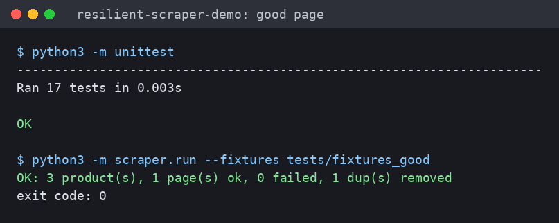
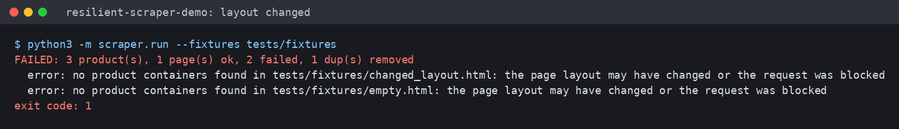

# resilient-scraper-demo

A small scraper in Python, with no third-party packages. The point is what it does when things go wrong: if a page changes layout, comes back empty or the request is blocked, it stops with a clear error and a non-zero exit code. It does not write an empty or half-right CSV and carry on.

It is a demo. It runs on local HTML fixtures with dummy products and has never been pointed at a real website.

## Try it

You need Python 3. There is nothing to install and no network is used.

```
python3 -m scraper.run --fixtures tests/fixtures_good
```

Expected output:

```
OK: 3 product(s), 1 page(s) ok, 0 failed, 1 dup(s) removed
```

That writes `output/products.csv` with 3 rows (one duplicate was dropped) and `output/run_report.json`, and exits 0.



## Watching it fail

`tests/fixtures` holds the same good page plus one with a changed layout and one that is empty. Run against all of them:

```
python3 -m scraper.run --fixtures tests/fixtures
```

```
FAILED: 3 product(s), 1 page(s) ok, 2 failed, 1 dup(s) removed
  error: no product containers found in tests/fixtures/changed_layout.html: the page layout may have changed or the request was blocked
  error: no product containers found in tests/fixtures/empty.html: the page layout may have changed or the request was blocked
```

The exit code is 1. The good page still gives its 3 rows, but the run as a whole counts as failed, so the two broken pages cannot slip through.



## How it is put together

```
scraper/fetch.py   fetch with retries, backoff, jitter and a delay before the request
scraper/parse.py   turn listing HTML into records, notice layout changes
scraper/run.py     command line: fetch or read fixtures, dedupe, write CSV and report, set the exit code
tests/             unittest suite and the HTML fixtures
```

Fetching: A request gets up to three attempts. Between attempts it waits `0.5 * 2^(n-1)` seconds, capped at 10, plus a random extra of up to half a second so several copies running together do not all retry at the same moment. It also waits one second before the first request and sends its own User-Agent. The HTTP function, the sleep function and the random source are all passed in, which is how the tests check the retry timing without a network or any real waiting.

Parsing: It uses the standard library's `html.parser` and reads name, price and URL from each product. If the product containers are missing, or one is missing a field, it raises a `ParseError` that says which. A page with no usable products is treated as a failure.

Running: `run.py` reads the pages, removes duplicates by URL (first one wins), writes `output/products.csv` and a JSON report with counts, errors and duration. Any error, or zero products overall, gives exit code 1, so cron or a monitor can see it.

You can give it live URLs instead of `--fixtures`, for example `python3 -m scraper.run https://example.invalid/listing`, and `--polite-delay` changes the wait before a request. I have only ever run it against the fixtures. With a live URL, the first page that cannot be fetched ends the run and is reported as an error.

## Tests

```
python3 -m unittest
```

17 tests, all offline.

## Before using it on a real site

The URLs in the repo use the reserved `example.invalid` domain. If you adapt this for a real site, read that site's terms of use and `robots.txt` first. The two screenshots in `docs/` come from running the commands above.
